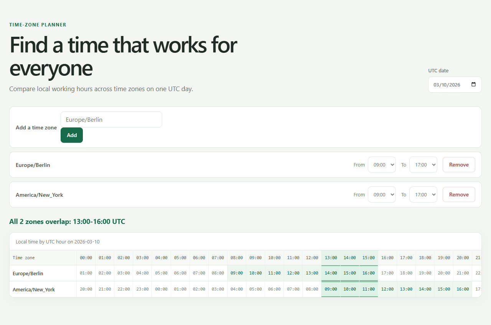

<p align="center"></p>

# zoneslot

A single-page tool that shows the working hours of several time zones side by side and highlights when everyone overlaps, for people planning calls across regions.

[](https://github.com/Gulliby-development/zoneslot/actions/workflows/ci.yml) [](LICENSE)



## Why

You are scheduling a call across, for example, Berlin, New York and Kolkata, and daylight saving starts on different dates in each of them. zoneslot converts every UTC hour of a chosen day to local time with the correct offset for that day and marks the hours at which all zones are inside their working hours. It runs entirely in the browser, uses only the built-in `Intl` API and has no date-library dependency.

## Install

Install [Bun](https://bun.sh/), then:

```sh
bun install
bun run dev
```

Open the address that Vite prints. To serve a production build, run `bun run build` and then `bun run preview`.

## Usage

The grid shows one UTC day: 24 columns, `00` to `23` UTC, with one row per zone. Each cell shows the local time of that UTC hour in that zone (`HH:MM`, so Kolkata at 13 UTC shows `18:30`). Cells inside the zone's working hours are marked as working; columns where every valid zone is working are highlighted, and a summary line states the shared hours.

A `+1d` or `-1d` marker beneath a time means its local calendar date is one day after or before the UTC date, respectively. The legend below the grid explains the markers. For example, `Asia/Kolkata` at 20 UTC reads `01:30` with a `+1d` marker.

The state lives in the URL hash, so a plan can be shared as a link. For example, Berlin and New York, both working 09:00-17:00, on 2026-03-10:

```text
#d=2026-03-10&z=Europe/Berlin@9-17,America/New_York@9-17
```

The summary for that hash is:

```text
All 2 zones overlap: 13:00-16:00 UTC
```

Hash format: `#d=<YYYY-MM-DD>&w=1&z=<zone>@<from>-<to>,<zone>@<from>-<to>`, with `d`, `w`, and `z` in that order. `from` is 0-23 and `to` is 1-24 (exclusive end). `w=1` skips weekends; `w=0` or a missing `w` does not. A missing `d` uses the current UTC date and a missing `z` means no zones. An invalid hash (unknown or duplicate zone, more than 8 zones, a bad date or hours out of range) is ignored and the default state is shown.

Stored time zone names are the browser's canonical names, as reported by `Intl`. A zone you type as `europe/berlin` is stored as `Europe/Berlin`, and depending on the browser's ICU data a name such as `Asia/Kolkata` may appear as `Asia/Calcutta`.

### Options

| Option | Description |
|---|---|
| Date | The UTC day shown in the grid. Defaults to today (UTC). |
| Add a time zone | An IANA zone name accepted by `Intl`, for example `Europe/Berlin`. Spaces around the name are ignored. Errors: `Enter a time zone name, for example Europe/Berlin` (empty entry), `Unknown time zone: <text> (try a name like Europe/Berlin)`, `Zone already added`, `At most 8 zones`. |
| From | Start of working hours in the zone's local time, 0-23 (default 9). |
| To | End of working hours, 1-24, exclusive (default 17). If From is not before To the row shows `Start must be before end` and is ignored in the overlap. |
| Skip weekends | When checked, Saturday and Sunday (in each zone's local calendar) are not working days. Off by default. |
| Remove | Removes the zone from the list. |

The summary reads `All N zones overlap: HH:00-HH:00 UTC` (several ranges are joined with `, `), `No common working hours on <date> (UTC)`, or `Add a zone to begin`.

### Local-time ranges

When zones share working hours, a list under the summary shows each shared range in each zone's local time. For the Berlin and New York example above on 2026-03-10, it reads:

```text
Europe/Berlin: 14:00-17:00
America/New_York: 09:00-12:00
```

### Skip weekends

With Skip weekends on, an hour counts as working in a zone only when the zone's local date for that hour is Monday to Friday.

```text
#d=2026-03-14&w=1&z=Asia/Tokyo@9-17,America/New_York@19-24
```

The summary for that hash is:

```text
No common working hours on 2026-03-14 (UTC)
```

Without `w=1`, the same zones give `All 2 zones overlap: 00:00-04:00 UTC`.

## Development

```sh
bun install
bun test
bun run typecheck
bun run lint
bun run build
```

The logic lives in pure modules (`src/overlap.ts`, `src/hash.ts`, `src/state.ts`); components take everything as props and are tested by rendering to a string. The overlap and cell tests depend on the ICU time zone data of the runtime.

## License

MIT, see [LICENSE](LICENSE).

---

Built with BAKED, an open-source coding agent (bench loop round 03, BAKED 5f13062).
